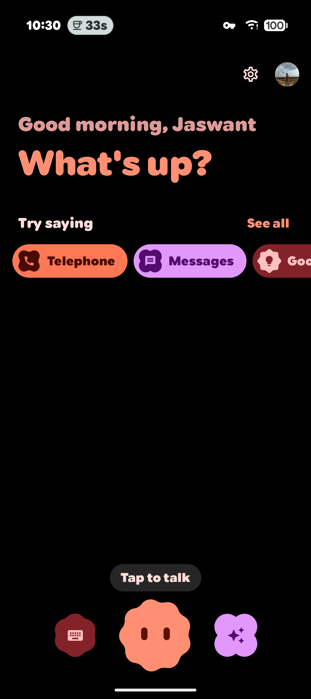
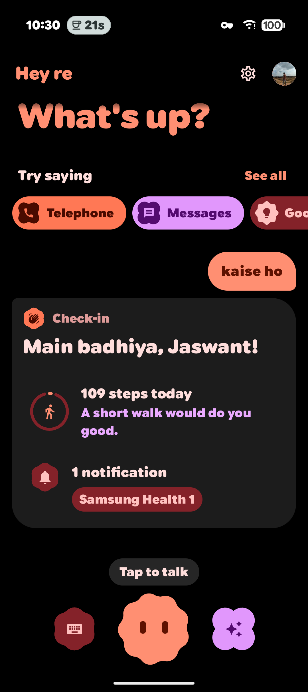
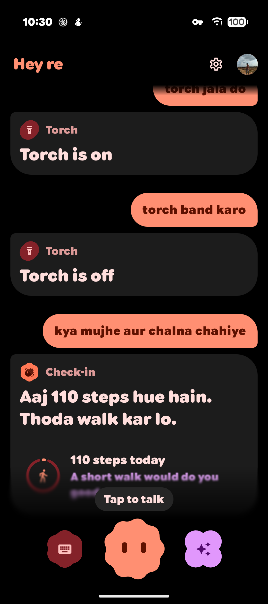
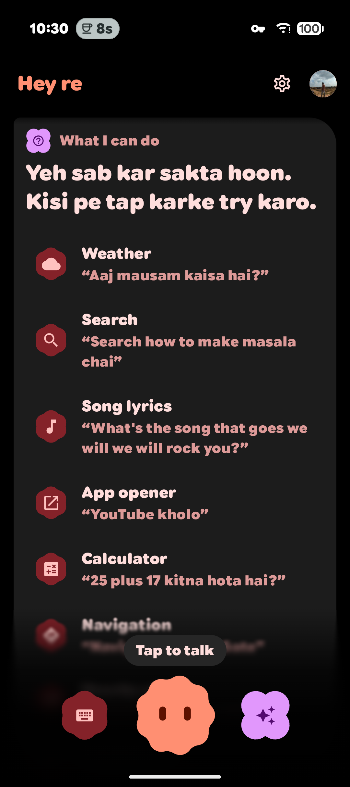
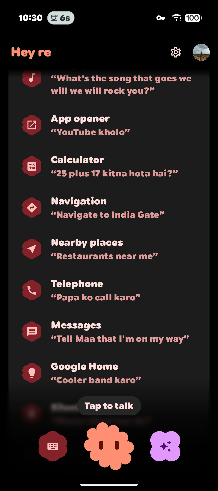

<p align="center">
    
</p>

# Hey re

Hey re is a **Hinglish voice assistant for Android**. Say "lights band karo", "Maa ko message karo ki main aa raha hun" or "kitne steps hue aaj", in Hindi, English or both in one sentence, and it does it. It works out what you said and answers **on the phone itself**, with Material 3 Expressive design and haptics throughout.

It's a personal fork of [Dicio](https://github.com/Stypox/dicio-android), built for one Pixel 9 and the way its owner talks. It isn't on any app store; you build it yourself.

<p align="center">
    
    
    
    
    
</p>

## What it does

| | Try saying |
|---|---|
| **Check-in.** Say hello and it tells you your steps, the Google Tasks due today and your unread notifications, and nudges you to walk around your office day | _hello, kaise ho_ · _kitne steps hue aaj_ · _kya mujhe aur chalna chahiye_ |
| **Calls and messages.** Calls and WhatsApp, SMS or Slack messages go out after a short countdown you can cancel; with Shizuku, WhatsApp sends without a tap | _Maa ko call karo_ · _Papa ko message karo ki late ho jaunga_ |
| **Google Home.** Your lights, plugs and cooler, now or later | _lights band karo_ · _cooler band karo ek ghante baad_ |
| **Phone switches** (through Shizuku). Wi-Fi, Bluetooth, mobile data, hotspot, airplane mode, Battery Saver, dark mode, Night Light, auto-rotate and location | _wifi band karo_ · _dark mode chalu kar do_ |
| **Sound** | _phone silent kar do_ · _dnd on karo_ |
| **Find Hub** (through Shizuku). Where your devices are, ringing them, and where you put things | _meri chabi kahan hai_ · _yaad rakhna ki passport almari mein hai_ · _ring my watch_ |
| **Phone status** (through Shizuku). Battery, storage and brightness, from Settings itself | _battery kitni hai_ · _storage kitna bacha hai_ · _brightness kam karo_ |
| **Time, timers and alarms** | _kitne baje hain_ · _paanch minute ka timer lagao_ · _subah 7 baje ka alarm laga do_ |
| **Reminders**, as a Clock timer or alarm labelled with what to remember | _2 ghante mein yaad dilana ki chhat se kapde lane hain_ · _remind me to take medicine at 9 pm_ |
| **Nearby places**, on Google Maps around where you are | _khane ki jagah dhundho aaspaas_ · _nearest ATM_ |
| **Notifications**, without the silent ones | _mere notifications batao_ |
| **What needs you.** Summon Hey re and say nothing, or ask: missed calls, people writing again or asking something, live updates like a delivery, tasks due, low battery or storage. Each is scored on its own and only the top few show, or none | _kuch important hai_ · _what did i miss_ |
| **Everything else from Dicio**: weather, search, lyrics, translation, calculator, jokes, media, torch, opening apps, directions | _aaj mausam kaisa hai_ · _gaana rok do_ · _youtube kholo_ · _torch jala do_ |
| **What it can do** | _tum kya kya kar sakte ho_ |

### Gemini Nano

On a Pixel 9 or newer, Gemini Nano runs on the phone and fills the gaps:
- **Rewording.** When no skill understands a sentence, Nano rewrites it as a command one does. If the guess would act (call, message, switch, Maps), Hey re asks "Did you mean …?" first.
- **Answers.** It answers small questions offline.
- **Your screen.** Summoned over an app, it can tell you what's on the screen ("summarise this", "yeh kya hai").
- **The whole article.** Over a page in Chrome, a second summary reads the whole article behind the link ("poora article batao"), not only what's visible. One-time links like sign-in or reset pages are never fetched.

### The assistant gesture and the lock screen

Make Hey re the phone's default assistant, then long-press the power button.
- **Over an app:** a sheet opens over whatever you're using, and you can ask about the screen.
- **In Hey re:** it jumps back to the conversation and listens.
- **Locked:** the time, timers, alarms, weather, torch and other harmless things answer straight away. Anything personal or that acts on the phone asks you to unlock first, then carries on.

### App functions

Android 16 lets apps publish tools for assistants ("app functions"): Find Hub publishes "where are my keys" and "ring this device", Settings publishes its switches and readings. Calling them needs a permission only Google's assistant holds, but the shell may, so Hey re calls them through Shizuku (`cmd app_function`). That's how the hotspot, Night Light, brightness, battery and storage work, and Find Hub. `adb shell cmd app_function list-app-functions` shows what's on a phone.

## Hinglish

- **Grammars.** The skills' sentence grammars include Hinglish in Roman letters.
- **Devanagari.** Hindi the recognizer writes in Devanagari ("लाइट बंद करो") is turned into the same Roman Hinglish, and Hindi number words ("paanch minute") into numbers.
- **Recognition.** On the Pixel build, Android's on-device recognizer switches between Hindi and Indian English within one sentence once both offline language packs are installed.

## Builds

| Flavor | For | Speech to text |
|---|---|---|
| `pixel` | Pixel 9 and newer (arm64), with Gemini Nano | Android's on-device recognizer, Vosk as a fallback |
| `foss` | Any Android 8+ phone, no Google AI | [Vosk](https://github.com/alphacep/vosk-api/) (~50 MB model, downloaded when first needed) |

```sh
./gradlew :app:assemblePixelRelease   # app/build/outputs/apk/pixel/release/
./gradlew :app:testPixelDebugUnitTest
```

The wake word, through [OpenWakeWord](https://github.com/dscripka/openWakeWord), still listens for _Hey Dicio_ by default; a custom `.tflite` model can be imported from Settings.

### Optional setup

- **Shizuku.** Install and start [Shizuku](https://shizuku.rikka.app/), then allow Hey re in it, for the phone switches and hands-free WhatsApp. Settings → Assistant & access shows its state.
- **Health Connect, Google Tasks and notification access.** The check-in asks for each the first time; tap its buttons.
- **Your own build with Google Home or Google Tasks.** These need an OAuth client in your Google Cloud project for the app's package and signing certificate, with the Home APIs and the Tasks API enabled.

## Tests

Besides unit tests, [`smoke/utterances.tsv`](app/src/test/resources/smoke/utterances.tsv) lists real sentences with the skill each must reach. `UtteranceSmokeTest` runs every line through the app's matching and Hinglish handling and writes the results to `app/build/reports/smoke.txt`. When something you said lands on the wrong skill, add it there.

## Privacy

Speech is recognized on the phone, and Gemini Nano runs on the phone. Steps, tasks, notifications and what's on your screen are read only to answer you, and are never stored or sent anywhere by Hey re. Skills that need the internet, like weather or search, say so. Details are in [PRIVACY.md](PRIVACY.md).

## Credits and license

Hey re is built on [Dicio](https://github.com/Stypox/dicio-android) by Stypox and its contributors, together with [dicio-sentences-compiler](https://github.com/Stypox/dicio-sentences-compiler) and [dicio-numbers](https://github.com/Stypox/dicio-numbers). To contribute to Dicio itself (translations, new skills), see [its documentation](https://dicio.stypox.org/).

Like Dicio, Hey re is licensed under the [GNU GPL v3](LICENSE).
